# Google Earth Engine Pre- and Post-Fire Image Pair Evaluation

**Description**

This Google Earth Engine (GEE) application supports post-fire mapping by
allowing users to browse satellite imagery, select a post-burn image, and
identify candidate pre-burn images for comparison. The application uses
the differenced Normalized Burn Ratio (dNBR) within an Extended Assessment
(EA) boundary outside the fire perimeter to help identify image pairs with
similar background conditions.

Candidate pairs are ranked by either the absolute mean dNBR closest to zero
or the lowest dNBR standard deviation. Comparing imagery outside the burned
area helps distinguish fire-related changes from differences in phenology,
moisture, and other background conditions. These rankings support visual
image selection; they do not replace review of scene quality or fire timing.

The application is implemented in
[GEE_PrePostFireImagePairs.js](scripts/GEE_PrePostFireImagePairs.js) and builds on
Justin Braaten's [EO Time Series Explorer](https://jstnbraaten.users.earthengine.app/view/eo-timeseries-explorer)
and RGB time-series charting module.

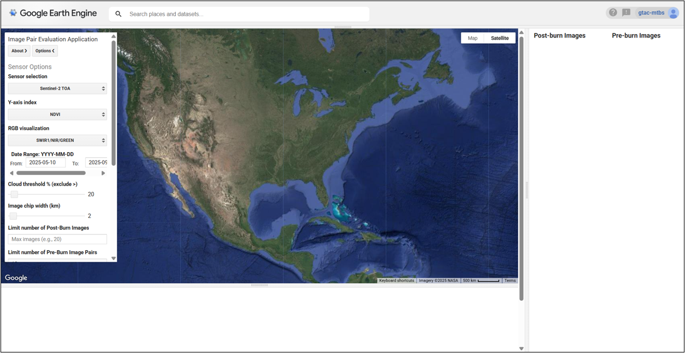

**1. Application Data and Supporting Tools**

The application combines satellite imagery, fire perimeters, assessment
areas, and image-quality screening tools within an interactive Google
Earth Engine interface.

The application uses predefined fire-perimeter assets derived from the
**Wildland Fire Interagency Geospatial Services (WFIGS)** Group, which
provides authoritative geospatial data products under the interagency
**Wildland Fire Data Program**. Users can load a fire perimeter using the
IRWIN (Integrated Reporting of Wildland Fire Information) ID stored in its
polygon record.

The application retrieves matching perimeters from a pre-uploaded WFIGS
collection using the IRWIN ID. It also supports loading an individual
fire-perimeter asset through **Import by Asset Path**.

WFIGS source data and metadata:

- [WFIGS Interagency Fire Perimeters — NIFC Open Data](https://data-nifc.opendata.arcgis.com/datasets/5e72b1699bf74eefb3f3aff6f4ba5511/about).
- [WFIGS Interagency Perimeters — ArcGIS REST feature service](https://services3.arcgis.com/T4QMspbfLg3qTGWY/arcgis/rest/services/WFIGS_Interagency_Perimeters/FeatureServer/0).

The following modules support charting, image preparation, and masking:

- **RGB time-series charting:** `users/jstnbraaten/modules:rgb-timeseries/rgb-timeseries.js`
- **Image preparation and masking:** `users/rcr-training/geeViz-js:getImagesLib.js`

The application uses pre-uploaded **WFIGS fire perimeters** and associated
**postprocessed external assessment areas**. The assessment areas are
**250 m wide**, extending from **60 m to 310 m outside the perimeter**.
These areas provide the outside-fire comparison region used to evaluate
background differences between candidate image pairs.

Additional inputs include Landsat Collection 2 imagery, harmonized
Sentinel-2 imagery, NLCD land cover, and precomputed cloud-score statistics.
The application also retrieves **precomputed TDOM (Temporal Dark Outlier
Mask) statistics for Landsat and Sentinel-2** to support additional shadow
masking. TDOM compares pixel reflectance with its temporal mean and standard
deviation to identify unusually dark observations. The application currently
applies TDOM to Landsat, while Sentinel-2 uses Cloud Score+ and snow masking.

**2. Specify Imagery and Display Options**

Open **Options** to select a sensor, date range, visualization, cloud
threshold, and image chip width. Click the map to specify the location
used to retrieve imagery. Importing a geometry also centers the map and
uses its centroid to populate the imagery panels and chart.

Supported sensor selections are:

- Sentinel-2 surface reflectance (SR) or top-of-atmosphere reflectance (TOA).
- Landsat 8/9 SR or TOA.
- Landsat 5/7 SR or TOA.

The date inputs use **YYYY-MM-DD** format. The selected date range controls
the browse imagery and chart; it does not automatically distinguish
pre-fire from post-fire acquisitions. Choose dates appropriate to the fire
being evaluated. Earth Engine date filtering generally treats the end date
as exclusive.

The cloud threshold excludes scenes whose collection-level cloud percentage
exceeds the selected value. This uses `CLOUDY_PIXEL_PERCENTAGE` for Sentinel-2
and `CLOUD_COVER` for Landsat. It is separate from the pixel-level masks used
to calculate image-pair statistics.

Available RGB combinations are:

- SWIR1 / NIR / Green.
- Red / Green / Blue.
- NIR / Red / Green.
- NIR / SWIR1 / Red.

The image chip width can be set from **1 to 10 km**. A white circle marks the
local sampling area on the map and thumbnails. Its radius is **30 m** for
Sentinel-2 and **45 m** for Landsat. This small sampling area is used for the
time-series chart, not for the EA-boundary image-pair statistics.

After changing options, use **Submit changes** to refresh imagery at the
current location.

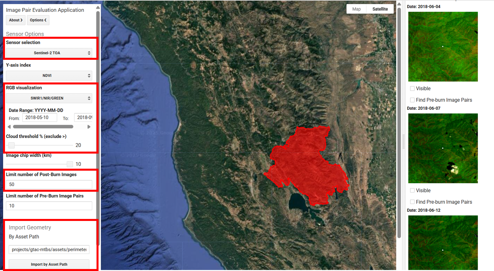

Each image card displays its acquisition date and an RGB
thumbnail. Select **Visible** to add the scene to the map.

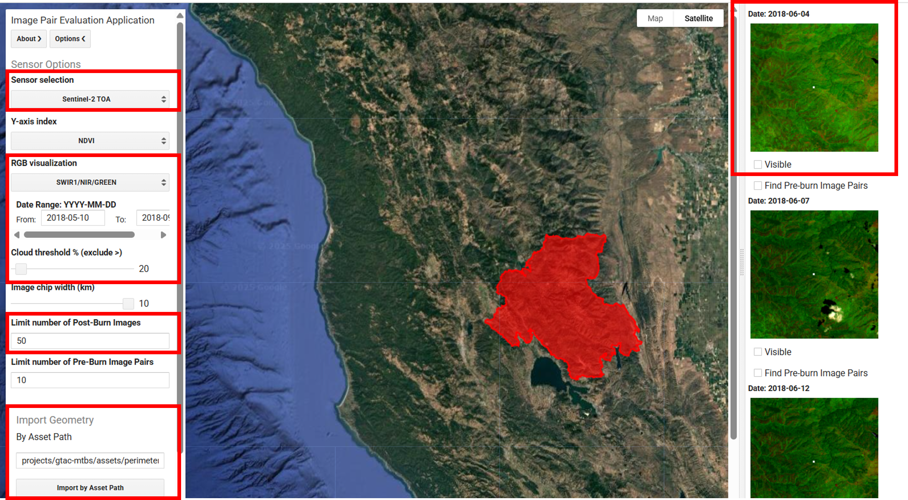

**3. Import a Fire Perimeter and EA Boundary**

The application provides two geometry-import methods:

- **By poly_IRWIN ID:** Enter the IRWIN ID stored in the fire's polygon
  record and select **Import poly_IRWIN + EA Boundary**. The application
  loads the first matching WFIGS perimeter and its associated postprocessed
  EA boundary. The IRWIN identifier links the fire perimeter to its
  assessment area.
- **By asset path:** Enter an Earth Engine feature-collection asset path
  for an individual perimeter and select **Import by Asset Path**. The application
  creates a **250 m-wide external donut** from the imported geometry by
  subtracting a **60 m buffer** from a **310 m buffer**, providing an
  assessment region for that perimeter.

Use **Show imported geometry** and **Show EA boundary** to control boundary
visibility. Hiding a boundary does not remove it from the analysis.

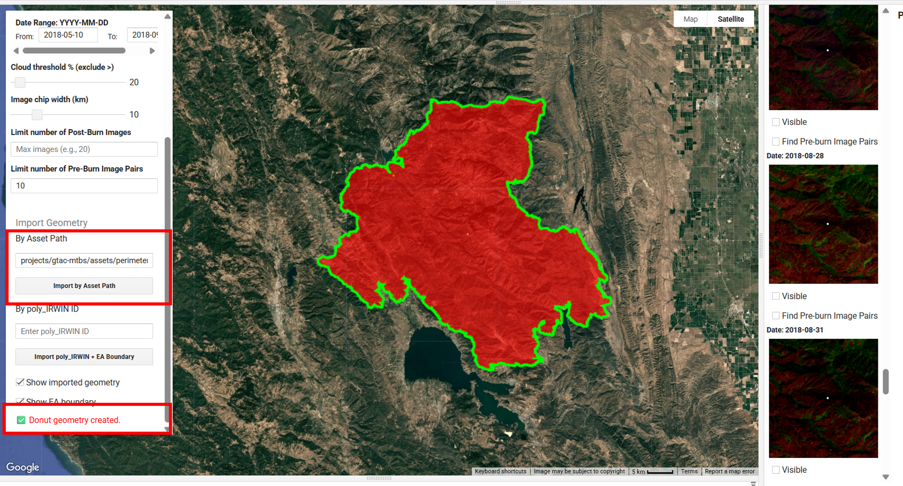

**4. Browse Post-Burn Images**

The right side of the application contains separate **Post-burn Images**
and **Pre-burn Images** panels. 

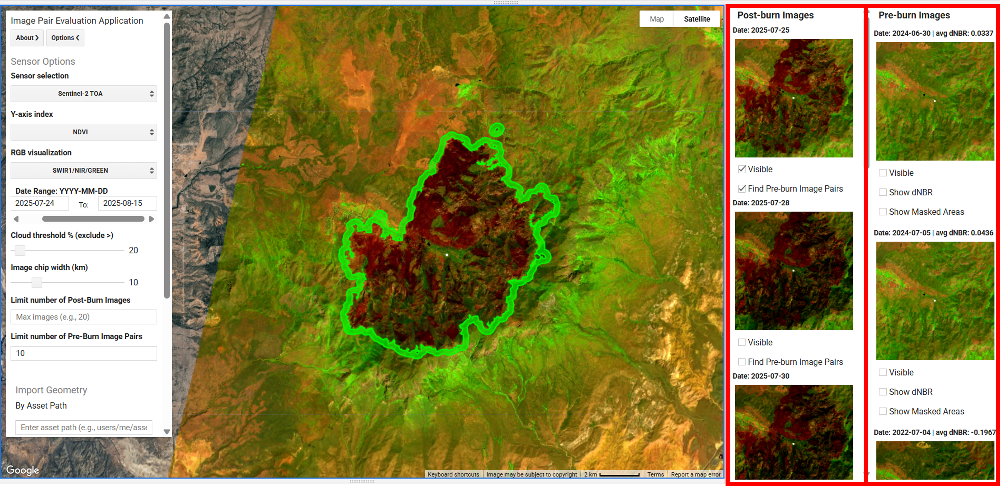

The post-burn panel is populated using the
selected sensor, location, date range, and scene-level cloud threshold.

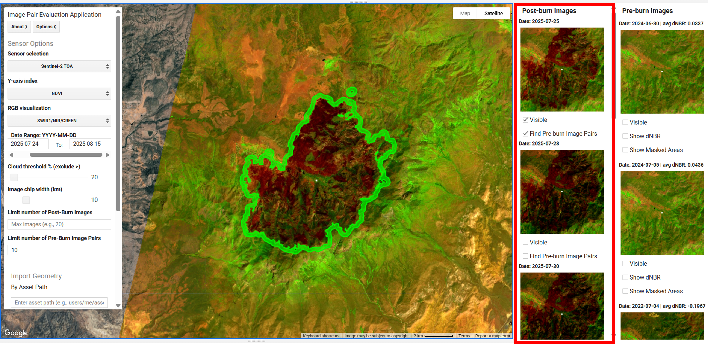

**Limit number of Post-Burn Images** optionally restricts the browse
collection to the specified number of least-cloudy scenes. Those scenes
are then displayed in chronological order. 

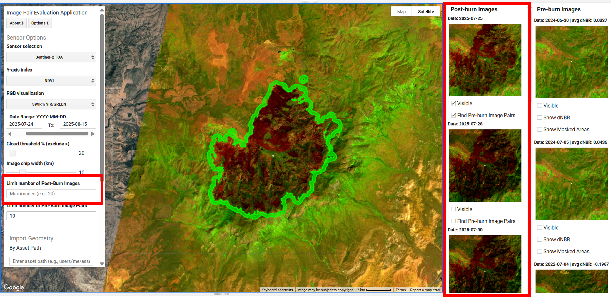

**5. Find Candidate Pre-Burn Image Pairs**

Select **Find Pre-burn Image Pairs** on the desired post-burn image card.
The application evaluates candidate pairs within the imported or generated
EA boundary.

The search uses the selected post-burn acquisition as its anchor date.
For each prior year, it retrieves imagery within the user-defined seasonal
window. The current controls default to:

- **Number of years prior:** 1 year.
- **Number of days (±):** 30 days.
- **Limit number of Top Pre-Burn Image Pairs:** 10 images.

The search-window controls allow a broader search, such as **3 prior years
and ±45 days**, to explore additional images with similar seasonal timing.

Historical imagery uses the selected sensor and scene-level cloud
threshold. Before computing pair statistics, the application retains up to
**50 of the least-cloudy historical candidates** across the search windows.

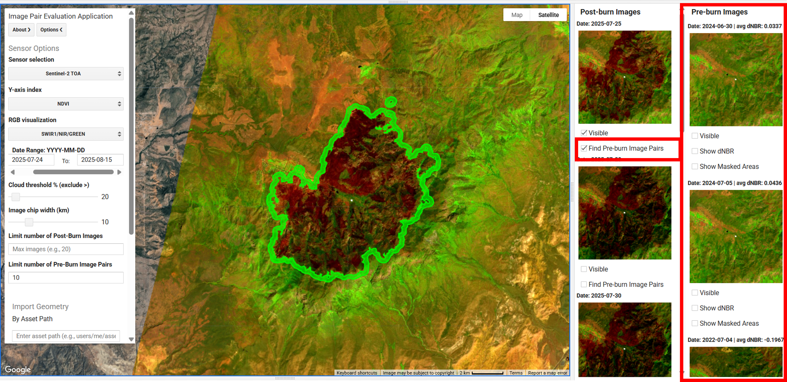

**5.1 dNBR Calculation and Pixel Screening**

NBR is calculated from NIR and SWIR2 reflectance. The script scales NBR by
**1,000**, rounds it, and stores it as a signed 16-bit integer. dNBR is
calculated as **pre-burn NBR minus post-burn NBR**, so the displayed values
and thresholds use scaled NBR units rather than a −1 to 1 index scale.

Candidate statistics are calculated within the EA boundary after applying
pixel-level quality masks to both images. The current configuration uses:

- **Sentinel-2:** Cloud Score+ (`cs_cdf`) with a minimum score of **0.65**,
  plus a snow mask. Cloud-probability masking and Sentinel-2 TDOM are disabled.
- **Landsat:** Cloud-score masking and TDOM shadow masking. There are additional masking options including 
  Fmask cloud, cloud-shadow, and snow masks, but these are currently disabled.

The calculation further restricts pixels to selected NLCD land-cover classes:

- 41: Deciduous forest.
- 42: Evergreen forest.
- 43: Mixed forest.
- 51: Dwarf scrub.
- 52: Shrub/scrub.
- 90: Woody wetlands.

The script selects the NLCD year closest to the post-burn image year from
**2001, 2004, 2006, 2008, 2011, 2013, 2016, 2019, and 2021**, using the
2019 and 2021 NLCD release collections. Candidate evaluation therefore
depends on valid coverage in those datasets and on the selected classes
being present within the EA boundary.

An initial mean dNBR is calculated without the additional quality and
land-cover screening. Quality-masked pixels must then fall within
**±200 dNBR units** of that initial mean. The refined mean, standard
deviation, and pixel count are calculated from the remaining pixels at
**20 m** for Sentinel-2 or **30 m** for Landsat, with Earth Engine's
`bestEffort` reduction enabled.

Candidates are retained only when:

- Refined mean, standard deviation, and count are all available.
- Refined dNBR standard deviation is **75 or lower**.
- At least **300 pixels** contribute to the refined statistics.

These thresholds are defined in the script rather than exposed as UI
controls. Small assessment regions, limited land-cover coverage, cloud
masks, or missing imagery can result in no qualifying pairs.

**5.2 Rank Candidate Pairs**

Use **Sort Pre-Burn Image Pairs using** to choose the ranking method:

- **|mean| (closest to 0):** Prioritizes the smallest absolute refined
  mean dNBR within the assessment boundary. This is the default.
- **standard deviation (lowest):** Prioritizes the most consistent refined
  dNBR values within the assessment boundary.

The pre-burn panel displays the top qualifying candidates in ranking order,
up to the requested limit. Each card includes the date, mean dNBR, standard
deviation, and an RGB thumbnail.

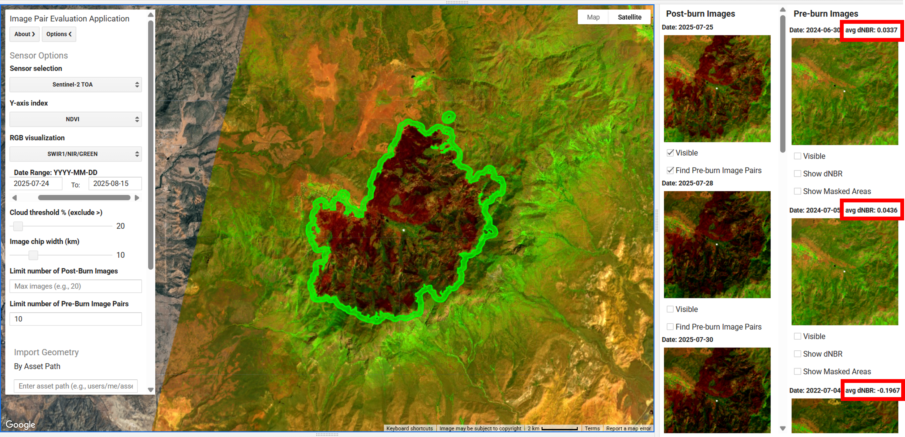

**6. Review Time-Series Patterns**

The chart displays mean **NBR**, **NDVI**, or a selected spectral band over
the small white sampling circle for the current browse date range. Available
bands are Blue, Green, Red, NIR, SWIR1, and SWIR2. Like NBR, NDVI is scaled
by **1,000** in the script.

Choose a pre-fire date range to examine seasonal greenness and leaf-out
patterns before selecting imagery with comparable phenology.

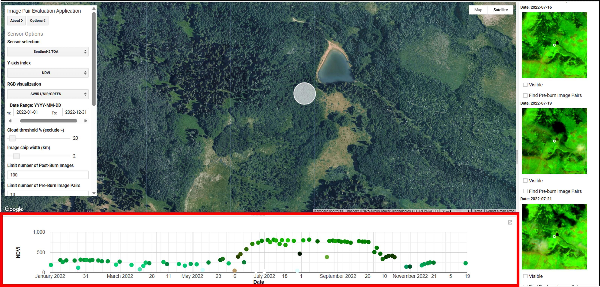

Choose a date range spanning or following the fire to inspect changes in
the selected index or band.

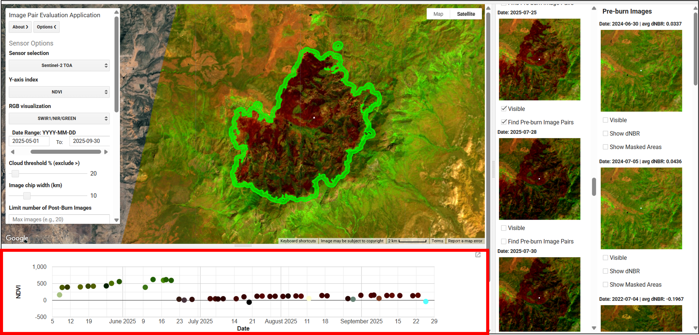

The chart uses the browse collection, not the ranked historical-pair
collection. Its imagery is not passed through the additional pixel-masking
workflow used for candidate statistics, so cloud effects may remain in the
chart. A post-burn image-count limit also limits the scenes shown there.

**7. Inspect Pre-Burn Imagery, dNBR, and Excluded Areas**

Each pre-burn card provides three display options:

- **Visible:** Adds the pre-burn RGB image to the map for comparison with
  the selected post-burn scene.

  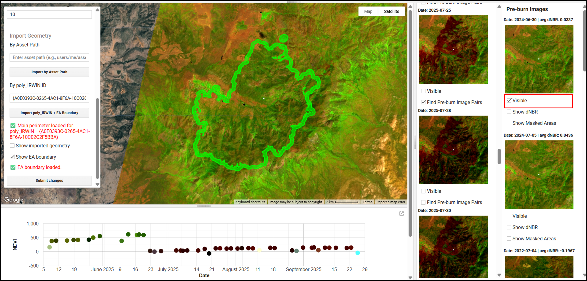

- **Show dNBR:** Displays the corresponding pre-minus-post dNBR image with
  a visualization range of **−1,000 to 1,000**. An opacity slider allows
  comparison with the underlying imagery. The displayed dNBR band is based
  on imagery without the additional statistical masks; it is not limited
  to the pixels used to calculate the refined statistics.

  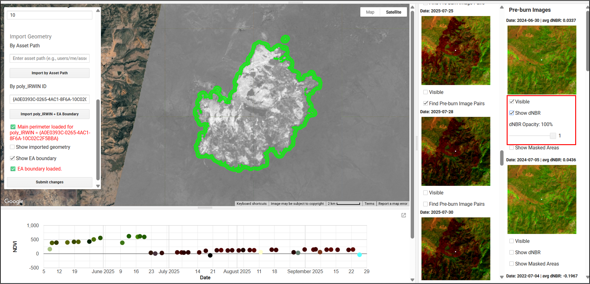

- **Show Masked Areas:** Displays a purple exclusion overlay assembled
  from the pre-burn quality mask, dNBR-range screening, and NLCD screening.
  The overlay is clipped to a **310 m buffer around the imported perimeter**,
  starts at **50% opacity**, and includes an opacity slider. It is a visual
  screening aid rather than a complete map of every invalid pixel in both
  images.

  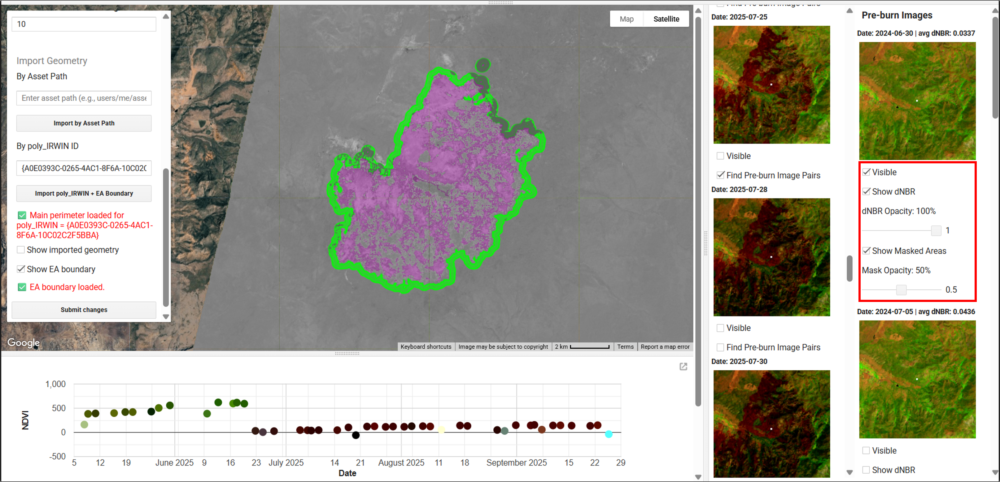

**8. Recommended Evaluation Workflow**

1. Import the fire perimeter and its EA boundary, or import an asset and
   use the generated external donut.
2. Select the sensor, post-fire date range, RGB combination, and cloud
   threshold; refresh the imagery as needed.
3. Review the post-burn thumbnails and chart, and display a suitable scene.
4. Set the prior-year search window, seasonal day window, ranking method,
   and candidate-count limit.
5. Select **Find Pre-burn Image Pairs** on the chosen post-burn card.
6. Review candidate statistics, RGB imagery, dNBR, and exclusion overlays.
7. Select an image pair based on both the ranking and visual assessment of
   scene quality, spatial coverage, phenology, and fire timing.

The current application supports browsing and evaluation only. It does not
include image export, burn-severity classification, or automatic selection
of a final mapping pair.

**9. Critical Application Components**

- GEE map, control panels, image thumbnails, and time-series chart.
- Harmonized Sentinel-2 and Landsat Collection 2 image preparation.
- WFIGS `poly_IRWIN` perimeter and EA-boundary lookup.
- Buffer-based assessment geometry for user-imported assets.
- Cloud, shadow, snow, land-cover, and dNBR-range screening.
- EA-boundary mean, standard deviation, and pixel-count statistics.
- User-configurable seasonal searches and candidate ranking.
- RGB, dNBR, and exclusion-mask display with opacity controls.

**Acknowledgments**

The application builds on Justin Braaten's
[RGB time-series module](https://github.com/jdbcode/ee-rgb-timeseries)
and EO Time Series Explorer, and uses the geeViz image-preparation library
referenced in the script.